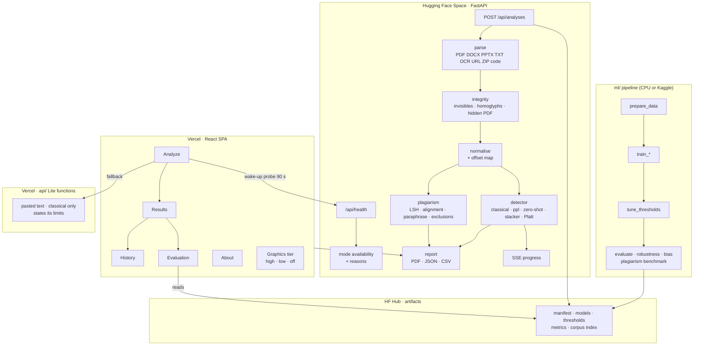

# Veritas — technical report

> **Artifact snapshot.** Every number in this report was read from `ml/artifacts/` produced by
> `python ml/run_all.py --smoke --force` on 2026-11-17 in a CPU-only sandbox (Python 3.11,
> no `torch`, no `sentence-transformers`, no pretrained weights). The bundle records
> `"run": "smoke"` and `"source": "cpu"`, and its own `metrics.json` carries the note
> "SMOKE RUN: this is a correctness check on a tiny sample and must never be presented as a
> result."
>
> **Therefore the numbers below are reported as pipeline evidence, not as results.** They show
> that every stage executes and that the reporting is wired to real files. A submission that
> wants result-grade numbers must run `ml/run_all.py` (CPU, real data) or the Kaggle pipeline
> (`docs/KAGGLE.md`) and re-read this report. Where a component could not run, this document
> says so and reports no number for it — that is the intended behaviour, not a gap to hide.

## 1. What was built

A three-part system:

* `backend/` — FastAPI service. Parsers for PDF, DOCX, PPTX, text/Markdown, images (OCR), URLs,
  ZIP archives and source code; an integrity scanner; a calibrated multi-component AI-text
  detector with four modes; a span-level plagiarism engine with exclusions, paraphrase
  verification, an opt-in online check, code similarity and batch comparison; PDF/JSON/CSV
  reports; SSE progress; SQLite history; per-IP rate limiting.
* `ml/` — seventeen-step pipeline (`ml/run_all.py`) producing every artifact the UI reads:
  splits, models, calibrated thresholds, metrics, robustness, bias, cross-generator transfer,
  baseline comparison, the plagiarism benchmark, the corpus index and the 3D projection.
* `frontend/` — Vite + React + TypeScript + Tailwind SPA with D3-light charts, three React
  Three Fiber scenes and 2D/Off fallbacks, plus a Vercel Lite deployment (`api/`) that scores
  pasted text and states exactly what it cannot do.

## 2. Architecture



## 3. Datasets

| dataset | role | size in this snapshot |
|---|---|---|
| **HC3** (Guo et al., 2023) via the `fangedvampire/ai_against_ai` GitHub mirror | human/ChatGPT pairs for training and evaluation | 24,322 rows available; a stratified subset is used per run |
| arXiv abstracts (`gcunhase/ArXivAbsTitleDataset`) | academic-style human text | used for the OOD split |
| Bundled corpus (`scripts/make_bundled_corpus.py`) | plagiarism corpus | 30 original documents, 68 passages |

* **Splits are group-disjoint by source document**, with the manifest hash written to
  `manifest.json` (`split_sha256`), so a re-run with changed splits is detectable.
* `test_ood` is held out by **domain and genre** and is **never** used for tuning;
  `ml/tune_thresholds.py` reads only `val_stack` and `val_cal`.
* The plagiarism corpus is small (30 documents) and **the number is printed next to every
  similarity percentage** in the UI.

Datasheet-style notes: no licensed or paywalled text is included; the bundled samples were
written for this project; no personal data is collected; the only outbound traffic is the
opt-in online source check.

## 4. Detector

### Modes and components

| mode | components | available in this snapshot |
|---|---|---|
| `lite` | `classical` | yes |
| `fast` | `classical` + `ppl_gpt2` | yes |
| `standard` | `classical` + `ppl_gpt2` + `binoculars` | **no** — `torch` absent |
| `deep` | `classical` + `fast_detectgpt` | **no** — `torch` absent |

`/api/health` returns this table with a `reason` for every unavailable mode — naming the
component that is missing, not merely the stacker built on top of it — and each result carries
`components_run` / `components_unavailable`. The UI disables a mode rather than letting
it fail, and never advertises one whose components did not run.

### Calibration and thresholds

Platt scaling on `val_cal` (never `test`), then two thresholds from the human score
distribution at a 1% false-positive target. The calibration guard requires ≥ 100 unique
calibrated scores; this snapshot has **480** (lite) and **480** (fast).

| mode | `t_human` | `t_ai` | human FPR at `t_ai` | AI miss at `t_human` | abstention |
|---|---|---|---|---|---|
| lite | 0.2505 | 0.9552 | 0.004 | 0.052 | 0.146 |
| fast | 0.4536 | 0.9716 | 0.004 | 0.052 | 0.122 |

`band_collapsed = false` for both.

### Metrics

Held-out first, because that is the honest headline.

**`test_ood` — held out by domain and genre**

| scorer | ROC-AUC | 95% CI | TPR @1% FPR | F1 | ECE | human FPR @ `t_ai` |
|---|---|---|---|---|---|---|
| lite (mode) | 0.8889 | 0.8572–0.9181 | 0.432 | 0.7359 | 0.2925 | 0.204 |
| fast (mode) | 0.9022 | 0.8748–0.9284 | 0.448 | 0.7303 | 0.3193 | 0.156 |
| classical (component) | 0.8871 | 0.8559–0.9162 | 0.448 | 0.7373 | — | — |
| ppl_gpt2 (component) | 0.7641 | 0.7206–0.8076 | 0.000 | 0.6684 | — | — |

**`test` — in-domain, optimistic by construction** (topics overlap with training)

| scorer | ROC-AUC | 95% CI | TPR @1% FPR | F1 | ECE |
|---|---|---|---|---|---|
| lite (mode) | 0.9768 | 0.9628–0.9873 | 0.764 | 0.9187 | 0.0159 |
| fast (mode) | 0.9764 | 0.9613–0.9871 | 0.768 | 0.9284 | 0.0332 |
| classical | 0.9752 | 0.9613–0.9860 | 0.772 | 0.9136 | — |
| ppl_gpt2 | 0.9206 | 0.8943–0.9420 | 0.584 | 0.6947 | — |

### What the verdicts actually look like

The confusion matrices below count verdicts at the tuned thresholds. Abstention is not a third
column in the 2×2: an abstained document is reported as "not AI", so it lands in the left-hand
column. The counts are published separately next to the matrix (and printed on the figure) so
the number of documents the system declined to call is never hidden inside a true-negative. Source:
`ml/artifacts/metrics.json → splits.<split>.modes.<mode>.confusion`.

| split | mode | true neg | false pos | false neg | true pos | abstained (human / AI) |
|---|---|---|---|---|---|---|
| `test` | lite | 249 | 1 | 71 | 179 | 34 / 60 |
| `test` | fast | 249 | 1 | 75 | 175 | 14 / 54 |
| `test_ood` | lite | 199 | 51 | 45 | 205 | 148 / 42 |
| `test_ood` | fast | 211 | 39 | 48 | 202 | 144 / 45 |

The asymmetry is deliberate: at a 1% false-positive target the system misses more AI text than
it accuses of human text, which is the right way round for a tool that must never be the only
reason a student is accused of something.

Accuracy by length is measured with the thresholds the system actually reports at, not a
magic 0.5 cut-off (`splits.<split>.modes.<mode>.accuracy_by_length`). Buckets below 100 words
abstain heavily, so their accuracy comes from a much smaller effective sample:

| length | lite accuracy | abstained | fast accuracy | abstained |
|---|---|---|---|---|
| **`test` `< 100`** | 0.8622 (n=196) | 37 | 0.8571 | 21 |
| **`test` 100–250** | 0.8293 (n=246) | 48 | 0.8211 | 41 |
| **`test` 250–500** | 0.9412 (n=51) | 8 | 0.9216 | 6 |
| **`test` 500+** | 1.0000 (n=7) | 1 | 1.0000 | 0 |
| **`test_ood` `< 100`** | 0.9293 (n=99) | 51 | 0.9091 | 46 |
| **`test_ood` 100–250** | 0.8083 (n=339) | 117 | 0.8201 | 121 |
| **`test_ood` 250–500** | 0.6140 (n=57) | 20 | 0.7193 | 21 |
| **`test_ood` 500+** | 0.6000 (n=5) | 2 | 0.8000 | 1 |

Read this carefully, because the naive reading is wrong:

* the `test_ood` `< 100` bucket *looks* better than the 100–250 bucket only because 51 of its 99
  documents were abstentions, and an abstention counts as "not AI" — which is correct for most
  of a balanced bucket but is not a decision;
* the threshold-free view says the opposite and is the one to trust on difficulty: `< 100`
  bucket AUROC **0.6661** against **0.8783** for 100–250 words. Short documents are genuinely
  harder; the accuracy column hides that behind abstentions;
* the `500+` bucket holds 7 and 5 documents. It is published with its `n` rather than dropped,
  but no conclusion should be drawn from it.

The lesson is exactly the one this project keeps relearning: an accuracy number without its
abstention rate and its `n` is not interpretable, which is why all three ship together.

Two things to read honestly here:

* the in-domain/in-the-wild gap (ROC-AUC 0.98 → 0.89, TPR@1% 0.76 → 0.43) **is the finding**;
  quoting the in-domain number alone would be the classic detector-paper mistake;
* **OOD calibration degrades** (ECE 0.02 → 0.29–0.32) and the human false-positive rate at the
  AI threshold rises to 0.20. This is reported as measured and **not** tuned away, because
  tuning on `test_ood` would make the number meaningless.

`ppl_gpt2` in this snapshot uses the **n-gram language model** backend (`ppl_backend:
"ngram_lm"`), not GPT-2: pretrained weights could not be downloaded in the build sandbox. The
backend is recorded in the manifest, in `/api/health` and in each result, so this is visible to
a reader rather than buried.

Hardware note: with `torch` available the same code path loads GPT-2 small, RoBERTa,
Binoculars and Fast-DetectGPT. Everything above was produced without them.

## 5. Robustness

Recall at each mode's own tuned threshold, with **`changed_fraction`** so a perturbation that
did nothing cannot be sold as robustness. `lite`, baseline recall 0.700:

| perturbation | recall after | changed fraction | with integrity cleaning |
|---|---|---|---|
| synonym replacement (10% of words) | 0.700 | 0.57 | — |
| synonym replacement (20%) | 0.690 | 0.69 | — |
| typos (3% of characters) | 0.700 | 0.945 | — |
| sentence shuffle | 0.700 | 1.00 | — |
| 30% human text mixed in | **0.565** | 1.00 | — |
| truncation to 100 words | **0.510** | 0.81 | — |
| homoglyph substitution | 0.685 | 1.00 | 0.700 |
| invisible characters | 0.700 | 1.00 | 0.700 |

Reading: token-level noise barely hurts a bag-of-ngrams classifier (typos, shuffling), while
**structure-changing** attacks do — mixing in human text and truncation cost 13–19 recall
points. The two integrity attacks are fully neutralised by the integrity stage (recall returns
to the clean baseline of 0.700), which is exactly what that stage exists for.

`paraphrase attack skipped: No module named 'torch'` — the T5 paraphrase attack needs a model;
it is listed as skipped in `robustness.json` rather than silently omitted.

## 6. Bias

Proxy definition (disclosed in `bias.json` and on the page): human test texts simplified to the
3,000 most frequent corpus words, with long sentences split at common connectors. This is a
**proxy** for non-native writing, not real ESL data.

| mode | normal human FPR | proxy FPR | difference | 95% CI | flagged |
|---|---|---|---|---|---|
| lite | 0.004 | 0.004 | 0.000 | [−0.012, 0.012] | no |
| fast | 0.004 | 0.004 | 0.000 | [−0.012, 0.012] | no |

The flag rule is stated up front and enforced in code: **flagged only when the 95% interval of
the difference excludes zero.** With 250 texts per side this interval is wide, so "not flagged"
here means "no detectable difference at this sample size", not "bias ruled out". A real ESL
corpus is listed as future work.

## 7. Plagiarism

Synthetic benchmark with known inserted spans — **labelled synthetic everywhere it appears**,
because a synthetic F1 is not a real-world rate. Test half only (the thresholds were tuned on
the validation half):

| metric | value |
|---|---|
| span F1, overall | **0.9412** |
| verbatim | 0.9593 |
| light edit | 0.9657 |
| reordered | 0.8963 |
| false alarms on negatives | 0.0 |
| target | 0.70 → **reached** |
| correlation, reported similarity vs. true copied fraction | 0.2354 |
| skipped obfuscation | `heavy_paraphrase` (needs a T5 model) |

Frozen thresholds: `lexical_min_containment 0.35`, `seed_gap_words 8`, `min_match_words 6`,
`semantic_min_cosine 0.8`, `rerank_min_score 0.6` (chosen on validation, F1 0.9217).

Honest weakness: the **similarity-vs-true-fraction correlation is weak (0.24)**. The engine
finds *where* the copied spans are much better than it estimates *how much* of the document is
copied, so the percentage should be read as a lower bound with wide error. This is stated in
the UI next to the number.

## 8. Cross-generator and baseline

* `cross_generator.json`: **empty and explained** — the available data has a single AI
  generator family (`chatgpt`), so leave-one-generator-out would leave no AI training data.
  No transfer number is reported rather than a meaningless one.
* `baseline.json`: **`available: false`**, reason `No module named 'torch'`. The third-party
  checkpoint (`Hello-SimpleAI/chatgpt-detector-roberta`) could not be downloaded here. The
  Evaluation page renders "not reported, and why" instead of a placeholder.

## 9. Interface

* Routes: Analyze, Results, History, Evaluation (OOD first), About, 404.
* Graphics tiers `high` / `low` / `off` with automatic detection (WebGL2, reduced motion, cores,
  memory, touch, frame-time probe) and a manual override in the header. With **Effects → Off**
  and with WebGL unavailable, every page keeps its content: the verdict number, thresholds,
  heatmap, similarity report, tables and plots are DOM, and the 3D scenes are replaced by
  equivalent 2D/HTML views.
* Document text is never uploaded to a GPU texture; scenes use procedural geometry only; no
  remote 3D assets; at most one canvas per page; rendering pauses off-screen and in hidden tabs.

## 10. Verification

| gate | result |
|---|---|
| `pytest -q` | 109 passed (API contract, text pipeline, detector, plagiarism, Lite functions, naming/no-placeholder gate) |
| `vitest run` | 59 passed (span maths, tier decision, API-base resolution, formatting, Viewer, page-level render tests) |
| `npm run build` | passes (TypeScript strict, three.js in its own lazy chunk) |
| `scripts/smoke.sh` | passes against a live server: health, version, samples, metrics, analysis, exports, history, retain=false, delete, corpus stats |
| `ruff check backend ml api tests` | clean |
| Playwright smoke | **not run in the build sandbox** — `cdn.playwright.dev` is unreachable, so `npx playwright install chromium` fails. `scripts/check_frontend.sh` prints `SKIPPED` for this stage. `docs/HUMAN_STEPS.md` §6 has the commands |

## 11. Limitations

1. **No GPU components ran in this snapshot.** `standard` and `deep` are untested against real
   Binoculars / Fast-DetectGPT behaviour; they are reported unavailable, which is correct but
   not the same as validated.
2. **The in-the-wild gap is large** (TPR@1% 0.76 → 0.43). A 43% detection rate at a 1%
   false-positive budget is a research result, not a deployable accusation engine.
3. **OOD calibration is poor** (ECE ≈ 0.29–0.32, human FPR 0.20 at `t_ai`). The probability
   should not be read as a literal chance on out-of-domain text.
4. **The plagiarism corpus is tiny (30 documents)**, and the similarity percentage correlates
   only weakly with the true copied fraction.
5. **The bias check uses a proxy.** Absence of a flag is not absence of bias.
6. **Robustness to real paraphrase is unmeasured** (the attack was skipped) and the
   structure-changing attacks that were measured do work.
7. **The interval shown with each probability is a heuristic**, not a formal posterior.

## 12. Ethics

Detection is used to *inform* a reader, never to accuse. The UI states this on every result, the
PDF report repeats it, and the API returns it in `disclaimer`. Documents are deleted as soon as
the analysis ends unless retention is requested; the online source check is off by default and
lists exactly which sentences it sent. Formal and non-native writing is where false positives
concentrate, which is why the bias check is published with its interval instead of being
summarised as "fair".

## 13. Reproducing this document

```bash
python3 -m venv .venv && .venv/bin/pip install -r backend/requirements-dev.txt
.venv/bin/python scripts/make_bundled_corpus.py
.venv/bin/python ml/run_all.py --force          # add --smoke for the ~2 min correctness run
cat ml/artifacts/metrics.json | python3 -m json.tool
```

Then re-read the tables above against the JSON. Any mismatch means this document is stale and
should be regenerated from the artifacts, not edited by hand.

### Figures

Every figure is produced by `ml/evaluate.py` from the same run as the tables, and served by the
API under `/api/metrics/plots/<name>`. The Evaluation page renders all of them in one gallery, ordered so the held-out variant of each
chart comes before the in-domain one, with a "held-out only" filter; none are hand-drawn.

| file | what it shows |
|---|---|
| `roc_test.png` / `roc_test_ood.png` | ROC curves per mode and per component, both splits |
| `pr_test.png` / `pr_test_ood.png` | precision-recall, the honest view under class imbalance |
| `calibration_test*.png` | reliability diagrams before and after Platt scaling |
| `distributions_test*.png` | score distributions for human and AI texts, with the two thresholds |
| `confusion_test*.png` | the matrices in the table above, as counts |
| `accuracy_by_length_test*.png` | the length table above, as a line per mode |
| `split_lengths.png` | document-length distribution per split, to expose the length confound |

`scripts/finalize.sh` checks that each of these exists and is newer than the manifest, so a
stale figure cannot be shipped as if it described the current model.
